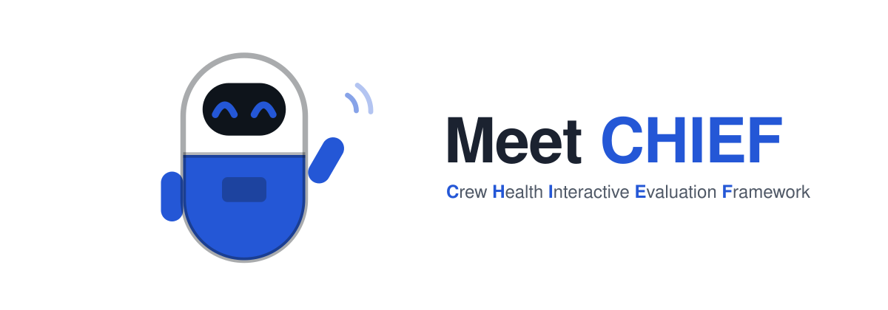
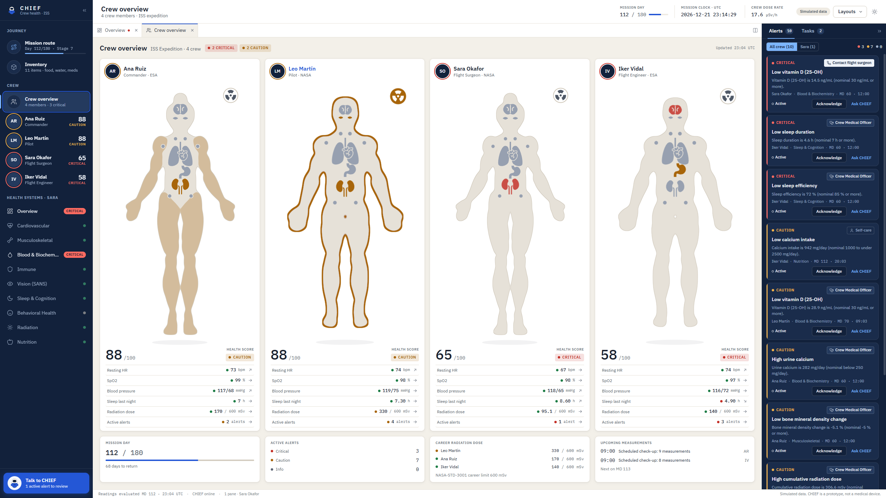
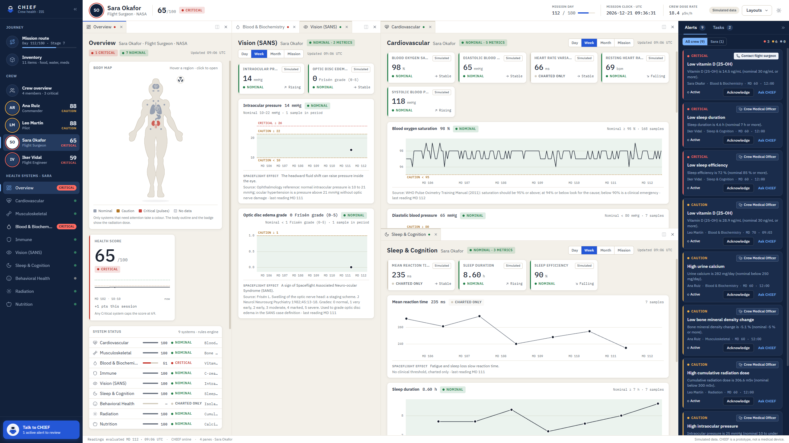
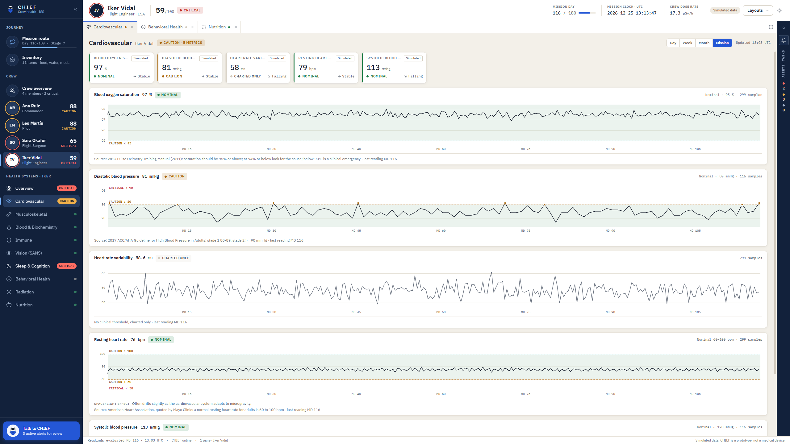
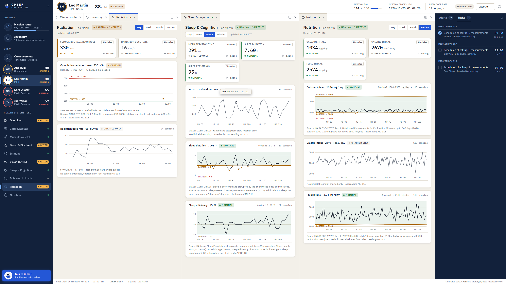
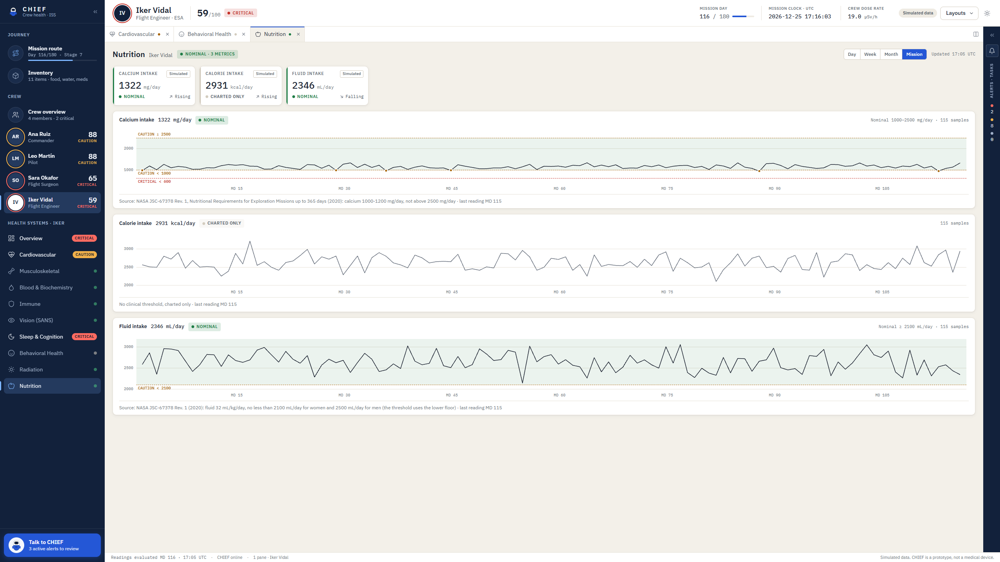
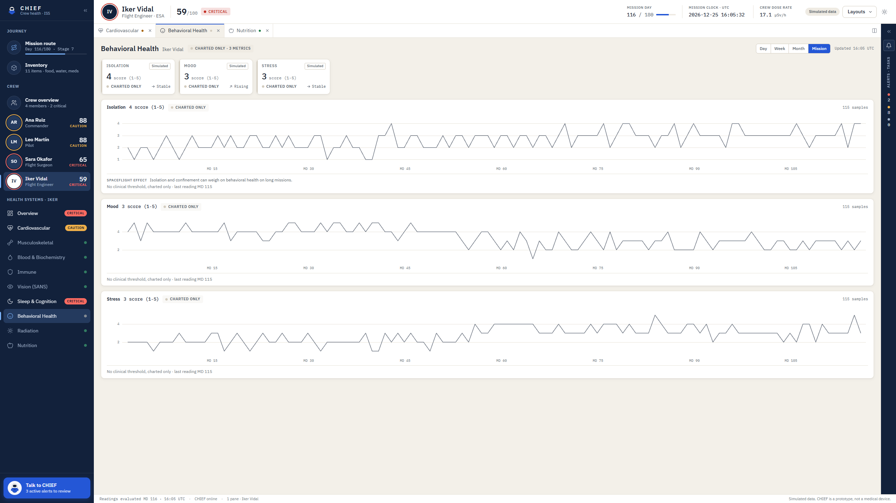
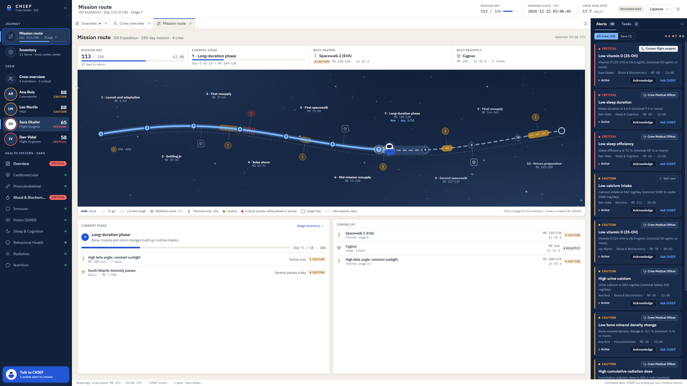
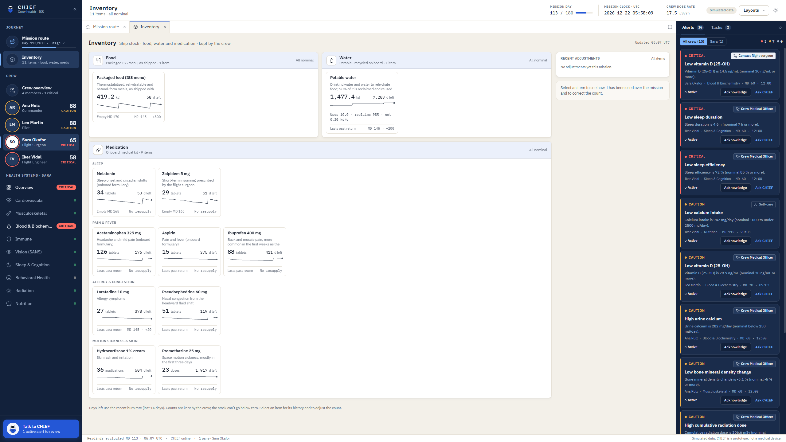
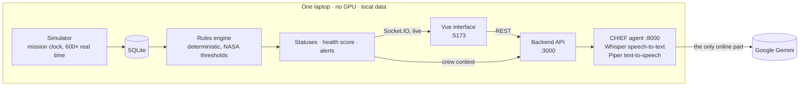

<p align="center"></p>

# CHIEF: the health system a spacecraft could carry

> **NASA Space Apps Challenge.** A visual tool that helps astronauts assess their own health
> during a mission and tells them what to do about it.

CHIEF watches every crew member of a six-month ISS mission, live. A deterministic rules
engine, built on NASA standards, turns the station's readings into a status for each body
system. **CHIEF**, an AI assistant you can talk to, explains in plain words what is wrong
and what to do: which tasks to avoid, what to eat, which medication from the onboard kit to
take, and when to call the flight surgeon. It also plans the road ahead: the radiation and
heat hazards of the coming weeks and the medication, food and water left on board.



<sub>All data is simulated from NASA datasets and standards. CHIEF is a hackathon prototype,
not a medical device.</sub>

---

## Contents

1. [Try it in one command](#try-it-in-one-command)
2. [A three-minute tour for the jury](#a-three-minute-tour-for-the-jury)
3. [The challenge and our answer](#the-challenge-and-our-answer)
4. [What you will see](#what-you-will-see)
5. [How it works](#how-it-works)
6. [Built on NASA science and data](#built-on-nasa-science-and-data)
7. [Why it matters](#why-it-matters)
8. [Safety by design](#safety-by-design)
9. [Engineering quality](#engineering-quality)
10. [Repository map](#repository-map)
11. [Team](#team)

---

## Try it in one command

### What you need

| | Required? | What for |
| --- | --- | --- |
| [Node.js](https://nodejs.org) 20 or newer | **Yes** | The app: interface, backend, simulator, rules engine |
| [Python](https://www.python.org) 3.11 or newer | Recommended | CHIEF's AI answers and its own voice (speech-to-text and text-to-speech run locally, on CPU) |
| A free [Gemini API key](https://aistudio.google.com/apikey) | Optional | CHIEF's conversational answers. Without it, CHIEF still answers in *fallback mode* with the sourced recommendations of the rules engine |

No GPU, no Docker, no cloud account. Everything runs on one laptop.

### Run it

```bash
git clone https://github.com/oscar-dom/SpaceAppsChallenge-CHIEF.git
cd SpaceAppsChallenge-CHIEF
```

| System | Command |
| --- | --- |
| **Windows** | Double-click **`start.cmd`** (or run `start.cmd` in a terminal) |
| **macOS / Linux** | `./start.sh` |
| **Any** | `npm start` |

The launcher does everything, and only what is still missing:

1. Checks Node.js and installs the JavaScript dependencies.
2. Finds Python 3.11+, creates the agent's virtual environment and installs CHIEF, including
   the voice models (the first run downloads a few hundred MB; later runs start in seconds).
3. Asks for a Gemini key once (press Enter to skip) and keeps it in the git-ignored
   `agent/.env`.
4. Loads a fresh demo mission: day 60 of 180, four crew members, two months of history.
5. Starts the backend, the interface and CHIEF, and opens **http://localhost:5173**.

Press **Ctrl+C** to stop everything. If Python is missing, the app still runs: CHIEF answers
in fallback mode and voice uses the browser.

| Option | Effect |
| --- | --- |
| `--lite` | Skip the voice packages: a much smaller install, voice uses the browser |
| `--no-agent` | Do not set up or run the Python agent (fallback mode) |
| `--keep-data` | Keep the current mission instead of a fresh demo |
| `--no-open` | Do not open the browser |

Example: `./start.sh --lite` or `start.cmd --lite`.

<details>
<summary><b>Manual setup</b> (developers)</summary>

```bash
npm install                                   # JavaScript workspaces: shared, backend, frontend

cd agent                                      # Python agent
python3 -m venv .venv                         # Windows: py -m venv .venv
.venv/bin/pip install -r requirements-voice.txt -r requirements-dev.txt
cp .env.example .env                          # then set GEMINI_API_KEY (optional)
.venv/bin/python -m piper.download_voices en_US-ryan-medium --download-dir models/piper
cd ..

npm run db:reset -w backend                   # fresh demo mission
npm run dev                                   # backend :3000, frontend :5173, agent :8000
```

Details: [`agent/README.md`](agent/README.md), [`backend/README.md`](backend/README.md),
[`frontend/README.md`](frontend/README.md).

</details>

<details>
<summary><b>Troubleshooting</b></summary>

- **A port is busy (5173, 3000 or 8000):** stop the other program, or close a previous CHIEF
  run with Ctrl+C.
- **"Python 3.11+ not found":** install Python and run the launcher again, or keep going in
  fallback mode. On Windows, the launcher uses the `py` launcher that comes with Python.
- **CHIEF says it is offline or in fallback mode:** no Gemini key, or the free quota is used
  up. Statuses, alerts and recommendations keep working; add a key in `agent/.env`.
- **Start the mission again:** run the launcher without `--keep-data`, or
  `npm run db:reset -w backend`.

</details>

---

## A three-minute tour for the jury

The mission clock runs **600× faster than real time** (one real second is ten mission
minutes), so the data moves while you watch.

1. **Crew overview.** Four astronauts, four body maps. Organs light up only when something
   needs attention. Sara and Iker are **critical**: spot why in one glance.
2. **Click Iker.** His overview shows the body map, the health score and the nine body
   systems. *Sleep & Cognition* is critical: open it to see the trend, the threshold bands
   and the NASA source behind every line.
3. **Click an alert on the right, then *Ask CHIEF*.** CHIEF reads Iker's data and returns
   concrete actions with their escalation level: what Iker can do himself, what needs the
   crew medical officer, and when to call the flight surgeon.
4. **Talk to CHIEF** (bottom left). Type or hold the microphone and ask *"How is Sara
   doing?"*. CHIEF answers and, for a voice question, speaks back.
5. **Mission route.** The 180 days as a path in 10 stages, with CHIEF as the ship. Hover the
   red marker: the **real May 2024 solar storm** (NASA DONKI), what it does and what to do.
   Click a stage to see what the crew consumed in it, or a forecast for the stages ahead.
6. **Inventory.** Food, water and medication with days of supply at the recent burn rate.
   Sleep medication is running low because Iker sleeps badly; select it, see its history,
   and correct the count as a crew member would.

---

## The challenge and our answer

**The challenge:** build a visual tool that helps astronauts assess their own health during
a space mission and gives guidance on treatments and health improvements.

On a long mission the crew is far from a doctor. Bone and muscle melt away, fluids shift
toward the head and press on the eyes, sleep breaks down with sixteen sunrises a day,
radiation adds up, and stores of food and medicine are finite. Today, much of this is
interpreted by experts on the ground. As missions go farther, communication delays grow and
the crew must understand their own health.

**Our answer is CHIEF**, a health system integrated into the spacecraft:

- **It measures.** The station simulates what its sensors, lab analyses and in-app tests
  would record: 25 indicators across 9 body systems, each at its own cadence.
- **It judges, deterministically.** A rules engine compares every reading with a threshold
  taken from NASA standards or clinical guidelines, each with its source. No AI decides a
  status.
- **It explains and advises.** CHIEF turns the rules engine's output into plain words and
  concrete actions, limited to the onboard formulary, always with the escalation level.
- **It looks ahead.** The mission route shows the hazards to prepare for and the supplies
  that will run short.
- **It never leaves the crew alone.** If the AI is unreachable, every status, alert and
  sourced recommendation still works.

---

## What you will see

### One astronaut, every system, side by side

The workspace splits like a code editor: drag any section to the edge of a pane to compare
systems. Here, Sara's overview with her vision (SANS), cardiovascular and sleep dashboards,
and the alerts panel on the right.



- **Body map:** organs take a colour only in caution or critical, following the
  control-room practice of ISA-101: what is normal stays calm, problems stand out.
- **Health score:** a weighted score kept inside the band of the worst status, so a number
  never looks healthier than the colour next to it.
- **Alerts:** sorted by severity, each with who must act (self-care, crew medical officer or
  flight surgeon) and an *Ask CHIEF* button.

### Every metric, with its threshold and its source

Each body system is a dashboard: live values, trends, day / week / month / whole-mission
charts with the threshold bands drawn in, the spaceflight effect behind the metric, and the
document the threshold comes from.



| | |
| --- | --- |
|  |  |
| Radiation, sleep and nutrition side by side; the Tasks tab lists the measurements due in the coming days. | Nutrition against NASA's exploration-mission targets (JSC-67378). |

Behavioral health is charted without a status on purpose: isolation, mood and stress have no
validated in-flight threshold, so CHIEF shows the trend and does not pretend to judge it.



### JOURNEY: the road ahead

**Mission route.** The 180-day mission as a path in 10 stages, with CHIEF as the ship. Along
it: radiation (South Atlantic Anomaly passes, the replayed May 2024 solar particle event)
and thermal hazards (high beta angle, spacewalks), each with its effect, what to do and its
source, plus the cargo ships that resupply the station.



**Inventory.** Food, water and medication, with days of supply at the burn rate of the last
two weeks, history charts, forecasts to the end of the mission, and crew adjustments that
can never take the stock below zero. Water shows the station's recycling: about 10 kg used
a day, 98% reclaimed.



---

## How it works



| Layer | Technology | Role |
| --- | --- | --- |
| Interface | Vue 3, TypeScript, Pinia, Socket.IO, hand-drawn SVG charts | Live crew view, workspace with split panes, chat with voice |
| Backend | Node.js, Express, TypeScript, SQLite + Drizzle ORM | The only gateway: API, live loop, simulator, rules engine |
| Rules engine | Pure TypeScript functions, unit tested | Status per metric and system, health score, alerts |
| CHIEF | Python, FastAPI, Google Gemini | Explanations and recommended actions |
| Voice | faster-whisper, Piper | Speech-to-text and text-to-speech, locally, on CPU |
| Contracts | `shared/` TypeScript package | One set of types for interface and backend |

**The simulator** keeps a mission clock and writes each indicator at its own cadence (heart
rate every few minutes, blood panels weekly, vision checks less often), with realistic noise
and spaceflight trends such as bone loss. Two months of history are seeded so weekly and
monthly charts are full from the first second. **Demo scenarios** are planted on specific
crew members, so the alerts that matter appear: vitamin D deficiency, early SANS, sleep
deprivation, rising kidney-stone risk, accelerated bone loss and a solar storm.

**The rules engine** compares every reading with its threshold, takes the worst metric as the
system status and the worst system as the crew member's status, and computes a weighted
health score kept inside the band of that status. It raises one alert per metric out of
range and reminders for the scheduled measurements. It is the single source of truth for
every colour on screen.

**CHIEF** receives, from the backend, the crew member's profile, current statuses, active
alerts, recent trends and the onboard formulary. It answers with a chain of Gemini models:
if one is over quota or slow, the next one answers within a 15-second budget. If all fail, it
answers in fallback mode with the recommendations stored in the thresholds table.

---

## Built on NASA science and data

Every threshold and every use rate has a source; every simulated value is marked as such.
The full list, with how far each source was verified, is in
[`docs/data-sources.md`](docs/data-sources.md).

| Source | Used for |
| --- | --- |
| **NASA OSDR**, Inspiration4 (OSD-569, OSD-575) | Real preflight blood values of the crew (white blood cells, glucose) and the baselines of the simulator |
| **NASA DONKI** (space weather) | The real proton onsets of the May 2024 solar storm, replayed on board and on the mission route |
| **NASA-STD-3001** Vol. 1 Rev. C | Career radiation limit (600 mSv) |
| **NASA OCHMO** technical briefs | Bone mineral density targets, radiation protection |
| **NASA JSC-67378** (2020) | Calcium, fluid and energy intake for exploration missions |
| **NASA HRP Spaceflight Standard Measures** | Which indicators to track: sleep, cognition, immune, blood and urine chemistry, cardiovascular, behavioral |
| **NASA Life Support Baseline Values (BVAD)**, NASA/TP-2015-218570 | Daily food (1.83 kg) and water (2.5 kg) per crew member |
| **NASA**, ISS water recovery milestone (2023) | 98% of the water used is reclaimed |
| **ISS Medical Kit Checklist** (NASA, FOIA) | The onboard formulary, the only medication CHIEF may suggest |
| ISS medication and sleep studies (Wotring 2015, Barger 2014, NASA NTRS) | Which medication the crew uses most, and when |
| Clinical guidelines (AHA, ACC/AHA, ADA, AASM, WHO…) | Thresholds where NASA sets none, each cited |

**In numbers:** 25 indicators, 9 body systems, 17 thresholds with a cited source, 4 crew
members with real preflight baselines, 10 mission stages, 11 inventory items, 3 cargo ships.

---

## Why it matters

How CHIEF answers what the NASA Space Apps Challenge recognises:

| Award | How CHIEF answers it |
| --- | --- |
| **Best Use of Science** | Every status comes from a threshold in a NASA standard or a cited clinical guideline, never from the AI. Spaceflight effects (fluid shift, bone loss, SANS, sleep disruption, radiation) drive the simulation and are explained next to each metric. |
| **Best Use of Data** | Real NASA data in the loop: Inspiration4 blood values (OSDR) as baselines, the real May 2024 solar storm (DONKI) replayed live, life-support values from BVAD. Every simulated value is labelled; every source is listed. |
| **Best Use of Technology** | A deterministic rules engine and a generative AI, each doing what it does best; a resilient chain of language models with a guaranteed fallback; speech recognition and synthesis running locally on a laptop CPU; live data over WebSockets. |
| **Best Mission Concept** | Designed as an onboard system: one laptop, no GPU, local data, escalation levels that mirror how ISS crews work with their flight surgeons, and a route view that plans hazards and supplies ahead. |
| **Galactic Impact** | Autonomy for crews as missions go beyond quick contact with Earth: understanding one's own health, acting early and knowing when to escalate. |
| **Local Impact** | The same approach serves people far from a doctor on Earth: polar stations, ships, offshore platforms, remote clinics. |
| **Best Use of Storytelling** | CHIEF is a character, a medicine capsule dressed as an astronaut, that turns charts into a conversation. The mission route tells the mission as a journey. |
| **Art & Technology** | A custom interface designed like flight software, hand-drawn SVG body maps and charts, and an animated mascot. |
| **Most Inspirational** | Health that the crew can understand and act on, with an assistant that speaks to them. |
| **Global Connection** | A multi-agency crew (NASA and ESA), open source, built on open NASA data and documented for anyone to reuse. |

---

## Safety by design

- **The AI never decides.** Statuses, thresholds and alerts come from the deterministic
  rules engine. CHIEF only explains them.
- **Only the onboard formulary,** and no doses beyond it. CHIEF cannot invent medication.
- **Every recommendation states its escalation level** (self-care, crew medical officer,
  flight surgeon), and CHIEF says clearly when to contact the ground.
- **Always available:** without Gemini, the app keeps every status, alert and sourced
  recommendation.
- **Honest data:** simulated values are labelled *Simulated* on screen and in the database;
  indicators without a validated threshold are *charted only*.
- **Keys stay local:** the Gemini key lives in a git-ignored file; the browser never sees it.
- **Clear disclaimer** on every screen: a prototype, not a medical device.

---

## Engineering quality

- **164 automated tests:** 101 for the backend (rules engine, simulator, API, live loop,
  inventory), 33 for the interface, 30 for the agent.
- **Continuous integration** on every pull request: commit message rules, lint, type checks,
  tests and the agent's tests.
- **Typed contracts** shared by interface and backend; the agent's models mirror them.
- **Documentation per folder**, plus the data sources, the simulator, the database schema and
  the design decisions in [`docs/`](docs/README.md).

```bash
npm test             # all JavaScript tests
npm run typecheck    # TypeScript, every workspace
npm run lint         # ESLint
cd agent && .venv/bin/python -m pytest   # agent tests (Windows: .venv\Scripts\python)
```

---

## Repository map

```
frontend/   Vue interface (the crew's view)                     :5173
backend/    Express API, Socket.IO, simulator, rules engine     :3000
  data/       NASA datasets, thresholds, formulary, inventory, mission route, demo scenarios
agent/      CHIEF: Python FastAPI, Gemini, faster-whisper, Piper :8000
shared/     TypeScript contracts shared by frontend and backend
docs/       data sources, simulator, database, design (CHIEF's mascot)
video/      CHIEF animator and screenshots for the demo video
scripts/    one-command launcher (start.mjs) and dev helpers
```

---

## Team

| Member | Area | Technologies |
| --- | --- | --- |
| **Óscar Domínguez Álvarez** | AI assistant (CHIEF): LLM orchestration, clinical context, safety guardrails, speech-to-text and text-to-speech · Frontend UX: design system, body map, JOURNEY views · Demo video | Python, FastAPI, Pydantic, Google Gemini API, faster-whisper, Piper · Vue 3, TypeScript, SVG · HTML Canvas |
| **Carlos Gonzalez Marcos** | Backend: REST API, real-time updates, rules engine (statuses, health score, alerts), agent integration · Demo video | Node.js, Express, TypeScript, Socket.IO, Zod, Vitest |
| **Héctor San Cecilio Martín** | Data and simulation: database schema, NASA dataset ingestion, sourced thresholds, mission simulator, demo scenarios · Frontend UX: workspace windows, pane splitting and layout limits · Demo video | SQLite, Drizzle ORM, TypeScript, NASA OSDR and DONKI APIs · Vue 3, Pinia |
| **Hernán Platero Domínguez** | Frontend: application layout, crew navigation, dashboards and charts, alerts panel, chat | Vue 3, Vite, TypeScript, Pinia, Socket.IO client, SVG |

---

> **Disclaimer:** CHIEF is a hackathon prototype built for the NASA Space Apps Challenge. It
> is not a medical device and must not be used for medical decisions. All crew members are
> fictional and all readings are simulated from NASA data and standards.
